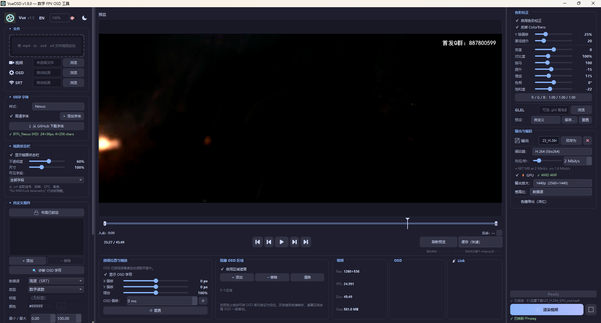
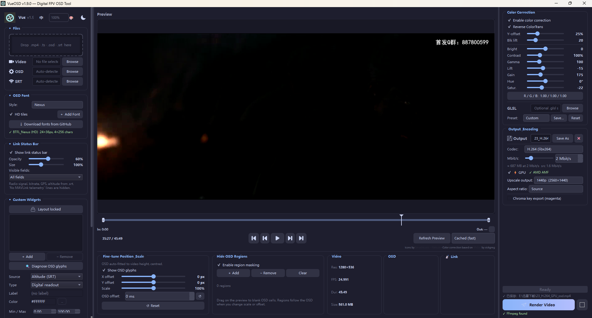

# VueOSD — 数字 FPV OSD 工具

> 语言：**简体中文** | [English](README_EN.md)

将 MSP-OSD 数据叠加到 FPV DVR 录制的视频上。支持 Betaflight、INAV、ArduPilot 和 BetaFPV P1。通过标准 MSP-OSD 格式兼容 [Ruby FPV](https://rubyfpv.com/) 和 [Onyx FPV](https://onyxfpv.com/)。

读取与视频一同录制的 `.osd` 和 `.srt` 文件，将 HUD 元素直接渲染到画面上——逐帧精确，GPU 硬件加速。

**中文界面**



**English UI**



---

## 本分支更新内容

- **修复「停止渲染」导致软件崩溃闪退的问题**：原实现在点击停止时强制杀死渲染线程（`QThread.terminate()`），会遗留孤儿 ffmpeg 进程占用 Intel QSV 的 GPU 会话，导致启用 GPU 后停止渲染必现闪退。现已改为协作式取消——停止时通知渲染循环安全退出，让 ffmpeg 正常收尾并释放 GPU 资源，可随时安全中断渲染。
- **添加中文界面**：全界面支持简体中文 / English 即时切换（点击标题栏的「中 / EN」按钮），语言选择自动保存，下次启动无需再次切换。
- **添加对化骨龙龙瞰（HGLRC Draco）图传录制 TS 文件的支持**：可直接读取 `.ts` 录制文件中内嵌的 OSD 数据（MPEG-TS / H.264 SEI，兼容 P1 格式），无需先转换成 MP4。
- **修复 Intel 显卡硬件渲染出错的 BUG**：修正 GPU 检测逻辑，避免 Intel 显卡被误判为 AMD AMF 导致 QSV 无法勾选；现在可正确识别并使用 Intel QSV（Arc / HD / Iris）。
- **修复 build.bat 打包报错**：原脚本硬性要求不存在的 `.venv` / `run.bat`，现已改为自动检测可用 Python 直接打包，无需 venv。

---

## 功能特性

- 逐帧精确的 OSD 叠加
- 支持 Betaflight、INAV 与 ArduPilot 字体（内置 SneakyFPV 高清字体）
- 从 OSD 文件头自动识别固件
- WTFOS / DJI O3 支持（自动识别 60×22 网格）
- BetaFPV P1 内嵌 OSD 支持
- 兼容 [Ruby FPV](https://rubyfpv.com/) 与 [Onyx FPV](https://onyxfpv.com/)（标准 MSP-OSD 格式）
- SRT 遥测信息栏（速度、高度、卫星数、信号）
- GPU 硬件加速编码（NVIDIA NVENC、AMD AMF、Intel QSV、VAAPI、VideoToolbox），自动回退 CPU
- ColorTrans 色彩校正，带 LUT 预览
- 透明叠加层导出（VP9 alpha）
- 裁剪、缩放、偏移、不透明度控制
- 内置视频播放器，支持拖动进度、逐帧和飞梭播放
- 双层预览合成（OSD / SRT 滑块即时响应）
- 键盘快捷键（播放、拖动、裁剪、飞梭、逐帧）
- 自定义字体导入（添加你自己的 OSD 字体）
- 放大输出至 1440p、2.7K 或 4K
- 目标码率编码（自动匹配源文件，1–100 Mbit/s）
- 浅色与深色主题，带自定义颜色编辑器
- 界面缩放（100% – 175%）

---

## 快速开始 — Windows

双击 **`VueOSD.bat`**

首次运行会自动：
1. 安装 Python 依赖
2. 安装 FFmpeg（通过 winget）
3. 启动程序

无需手动配置。

---

## 快速开始 — Linux / macOS

```bash
chmod +x run.sh
./run.sh
```

需单独安装 FFmpeg：
```bash
sudo apt install ffmpeg        # Ubuntu/Debian
sudo dnf install ffmpeg        # Fedora
sudo pacman -S ffmpeg          # Arch
brew install ffmpeg            # macOS
```

---

## 键盘快捷键

| 按键 | 功能 |
|-----|--------|
| 空格 | 播放 / 暂停 |
| 左 / 右方向键 | 后退 / 前进一帧 |
| Shift + 左 / 右方向键 | 后退 / 前进 10 帧 |
| J | 后退一帧 |
| K | 暂停 |
| L | 播放 / 提高速度 |
| I / O | 在当前位置设置入点 / 出点 |
| Home / End | 跳到开头 / 结尾 |

---

## 构建独立可执行文件

**Windows** — 首次启动后运行 `build.bat`（生成 `dist\VueOSD.exe`）
**Linux/macOS** — 运行 `./build.sh`（生成 `dist/VueOSD`）

生成的程序在目标机器上无需安装 Python。
Windows 下将其与 `ffmpeg.exe` 放在一起，或确保 `ffmpeg` 在 PATH 中。

---

## 手动安装

```bash
python3 -m venv .venv
source .venv/bin/activate      # Windows: .venv\Scripts\activate
pip install -r requirements.txt
python main.py
```

---

## 文件结构

```
main.py             主程序（PyQt6 图形界面）
player.py           视频播放器组件（画布、时间轴、控制条）
video_processor.py  FFmpeg 管线、GPU 检测、编码
osd_renderer.py     基于 Numpy 的 OSD 合成器（约 1 毫秒/帧）
osd_parser.py       .osd 二进制格式解析器
p1_osd_parser.py    BetaFPV P1 内嵌 OSD 提取器（MP4 + MPEG-TS）
i18n.py             中英文翻译与语言切换
srt_parser.py       .srt 遥测解析器
font_loader.py      OSD 字体加载器（多列高清字体）
fonts/              OSD 字体包（Betaflight、INAV、ArduPilot）
```

---

## 致谢

完整署名见 [CREDITS.md](docs/CREDITS.md)——包括 SneakyFPV（字体）
和 Walksnal（原始 OSD 工具构思）。

## 许可证

MIT — 见 [docs/LICENSE.md](docs/LICENSE.md)
